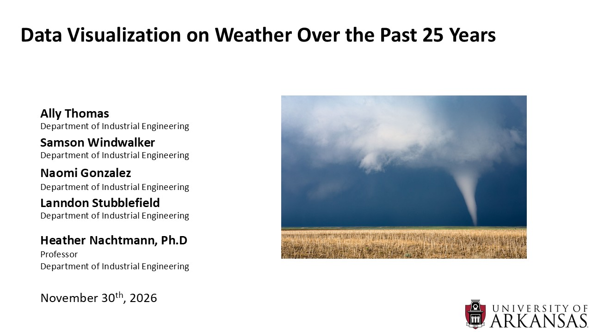

Weather affects everyday choices, from what we wear to how we prepare for severe storms, and weather data lets us test common weather assumptions. For this project, our team analyzed weather data and built one visualization for each of four questions. A bar chart compares average snowfall and minimum temperature in Arkansas to ask whether colder summers imply more snow. A histogram of monthly precipitation in Queens, NY shows what counts as a normal amount of rain. A scatter plot of yearly tornado events in Tornado Alley and Dixie Alley asks whether Tornado Alley is expanding east, shifting east, or not changing, and whether the two regions are related. Finally, a time series of Arkansas maximum temperatures from August to December in 2000, 2010, and 2020 shows whether “sweater weather” is arriving later.

![Do colder summers imply more snow? Using NCEI NOAA Global Summary of the Month’s data for stations across all of Arkansas we compared the minimum temperature in August vs the levels of snow in December, each ten years apart. We wanted to see if a colder summer implies more snow in the winter.To answer this question, we created a bar chart the year as the categories and temperature and snowfall as the dependent variables. We made two separate pivot tables, one for the average minimum temperature in August, and one for average snowfall in December. They were both filtered to Arkansas’ weather data only and to their corresponding months. We then combined these tables into one to make our clustered column chart with two different y axes for the corresponding dependent variables and their units. We then copy and pasted this graph over as a picture into a PowerPoint slide. Our results showed that colder summers do not reliably imply more snowfall in the winter since the coldest summer did not nearly have the most amount of snow.](Slide2.JPG)

![What is roughly normal for the rain levels in Queens, NY? On September 26th, 2026, the east coast experienced so much rain that a video was posted of a man kayaking to a train station. To gain a better understanding of just how unusual this much flooding was, we gathered data on rainfall from the years 2000 to 2025 and plotted the levels on a histogram. To create the histogram, we copied the State and Precipitation columns from our cleaned data set into a new sheet. We then filtered the state to New York since the only city that collected data from there was Queens. Then, we found the maximum and minimum levels of precipitation and number of records to determine a good bin width and scale. We then copy and pasted this graph over as a picture into a PowerPoint slide. Our results showed that roughly normal for the rain levels in Queens, NY is three to five inches of rain for a month. If Queens were to receive more than ten inches of rain in a month, then that would be quite rare.](Slide3.JPG)

![Does Tornado Alley appear to be expanding east, shifting east, or staying the same? With climate change bringing more storms with conditions suitable for tornados, there’s been a recent focus on the increasing tornado activity in Dixie Alley, a lesser-known tornado zone to the east of Tornado Alley. To see if the pattern of tornados really has been changing hotspots, data was collected from the NOAA WCM, where each dot represents information about a tornado and its date and location. Data was then cleaned and labeled as a tornado belonging to Tornado alley or to Dixie Alley. From our clean data, we made two pivot tables, one for Tornado Alley, and one for Dixie Alley. Our rows belonged to the years, and our column was the count of tornadoes for each year. Each table was filtered by its corresponding Alley and if a tornado was present for that record. Then, we combined the pivot tables into one table and made a scatter plot. We then copy and pasted this graph over as a picture into a PowerPoint slide. We discovered that tornadoes are shifting east since Tornado Alley’s trend line has an overall negative slope, while Dixie Alley’s is positive. Tornado Alley is more west than Dixie Alley, so tornadoes seem to be going east as time goes on.](Slide4.JPG)

![Does 'Sweater Weather' appear to be arriving later? The monthly data for three years across all of Arkansas was used to compare the average highs between the months of August to December. With the pressing issue of global warming, we wanted to see if temperature is really staying higher for longer. We made a pivot table from our clean data filtered to only the state of Arkansas. Our rows were the months August through December since we were only testing the back half of the year. We then took the average of the temperature maximum for the years 2000, 2010, and 2020 on our pivot table. Then, we copied the pivot table to a standard table but renamed the numbered months to their actual names (August instead of 8). Finally, we built a time series plot based on that table. We then copy and pasted this graph over as a picture into a PowerPoint slide. Our results showed us that “sweater weather” seems to be hitting at the same point, around October, for all years tested. However, in December we do see 2020 having the highest average max temperature. This is not relative to our question though, since we are only testing to see if the time temperatures drop occurs later.](Slide5.JPG)